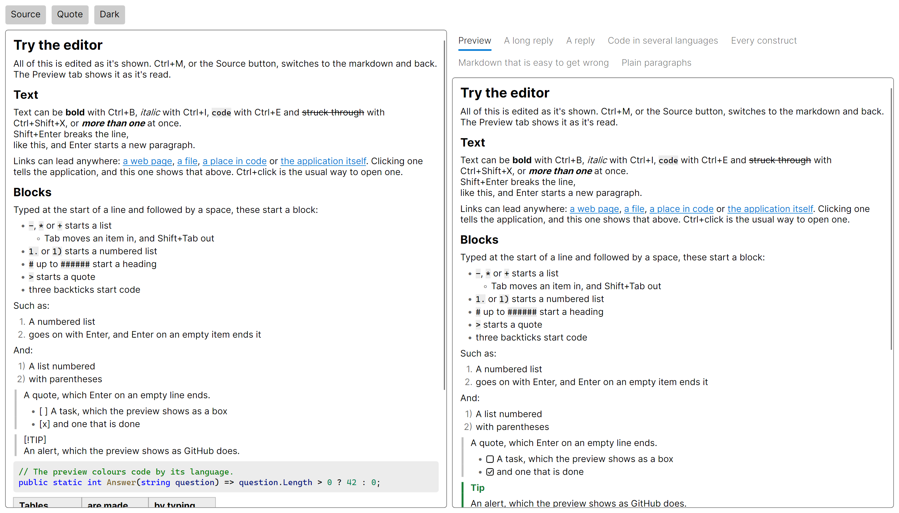

# Mavalonia

Controls for Avalonia®, for writing and reading messages in markdown, such as in an AI chat:

- **`MarkdownEditor`**, a WYSIWYG markdown editor that switches quickly between showing the markdown source and showing it rendered.
- **`MarkdownView`**, which shows markdown to be read. What a person selects in it is copied as markdown.

They are on nuget.org as the package `Mavalonia`. To use them in an application, see [using the controls in an application](https://github.com/mlidbom/Mavalonia/blob/main/dev_docs/using-the-controls-in-an-application.md). Why `MarkdownView` is as it is: [MarkdownView](https://github.com/mlidbom/Mavalonia/blob/main/dev_docs/markdown-view.md). What each version changed: [CHANGELOG.md](https://github.com/mlidbom/Mavalonia/blob/main/CHANGELOG.md).

The links are whole URLs, as this file is the package's page on nuget.org too.

| Project | Responsibility |
| --- | --- |
| `Mavalonia.Markdown` | Everything about markdown that needs no controls: reading it, rendering it and editing it. |
| `Mavalonia.Markdown.Controls` | The Avalonia controls |
| `Mavalonia.Markdown.Controls.Measurements` | Measures how fast the controls are. |
| `Mavalonia.DesktopHost` | The application in which to try the controls by hand: an editor that starts with a sample of all it does, and beside it tabs of what is written there as it's to be read and of sample documents to copy from. Each file in `Samples/Tabs` is a tab. |
| `Mavalonia.Markdown.Specifications` | Run in parallel, without UI. Most specifications belong here. |
| `Mavalonia.Markdown.Controls.Specifications` | Use real controls in windows that exist only in memory, one specification at a time. |

## How editing works

- **The markdown text is the document.** It is an AvaloniaEdit `TextDocument`, which works without a UI, and has undo. The rendered view and the source view edit the same one, so nothing is converted when switching, and markdown that isn't edited stays as it is written.
- **The rendered view shows no markup.** Each character it shows knows the markdown it stands for (`RenderedChar.Source`).
- **An edit says what is to be shown,** then finds the least change to the markdown that shows that, and verifies it by rendering the result (`TextReplacement`). Typing a space at the end of bold text must not stop it from being bold, though `**bold **` isn't.
- **Some markup is turned off in the editor** since people type it without meaning to: headings made by underlining, and code made by indenting. Both are shown as ordinary text. What is only read is in another dialect (`MarkdownDialect`).
- **A table is made when a new block is started** after a line such as `| a | b |`, or after all the lines of one. Typing makes none: the line under a header would make it when only a part of the line is there. Tab in the last cell adds a row, and starting a new block in an empty last row leaves the table.
- **Markup that isn't rendered is shown as source:** HTML, images, link definitions.
- **Rich text is pasted as markdown** (`CopiedHtml`). What has no markdown that we render loses its looks and keeps its text, and text that looks like markup is escaped, as little as possible: what is written is verified by rendering it. What is copied from an editor of code is pasted as its text, since it may be markdown. Only the clipboard of Windows is read for rich text; elsewhere its text is pasted.
- **The application can add a quote** (`MarkdownEditor.Quote`), and a person can paste one. The caret goes after it, to write what there is to say about it.
- **The application decides the keys** that start a new block and that break the line, and gets every key that the editor doesn't use, such as one that sends the message.

## Working with it

- **Run the specifications:** `dotnet test --solution Mavalonia.slnx`
- **Run one project's:** `dotnet test --project Mavalonia.Markdown.Controls.Specifications`
- **Try the controls, reloading code changes:** `dotnet watch --project Mavalonia.DesktopHost`
- **CI:** GitHub Actions builds the solution from a clean checkout and runs all the specifications on every push, on Windows: `.github/workflows/build-and-test.yml`. The build fails on any warning.
- **Measure how fast the controls are:** `dotnet run -c Release --project Mavalonia.Markdown.Controls.Measurements`, with how many messages as arguments, or none for 100 and 1,000
- **Make the picture above again:** `dotnet run --project Mavalonia.DesktopHost -- --screenshot images/desktop-host.png`. It draws the window off the screen, at twice its size.
- **Check that typing works on the real desktop:** `dotnet run --project Mavalonia.DesktopHost -- --check-typing`. The specifications run on the headless platform, which has no input methods. The window is off the screen and doesn't take the focus. The exit code is 0 when typing works.

## Specifications that use controls

- Put `[XFOnUIThread]` on them instead of `[XF]`: the constructors then run on the UI thread too.
- `HeadlessWindow` clicks, types and renders frames. A rendered frame saved with `SaveForInspectionAs` ends up in `artifacts/rendered-frames`.
- `Avalonia.Headless.XUnit` is not used: it [breaks on xunit.v3 4.x](https://github.com/AvaloniaUI/Avalonia/issues/22072), which Compze.xUnitBDD needs.

Avalonia is a registered trademark of AvaloniaUI OÜ. This project is not affiliated with it.
